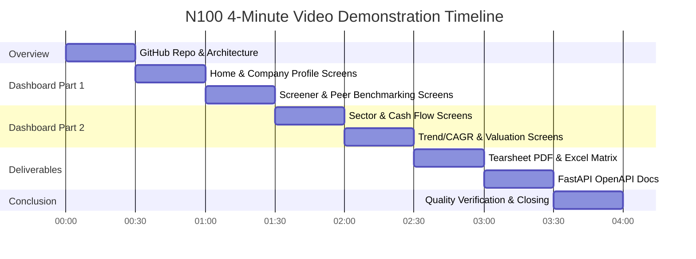

# N100 Financial Intelligence Platform — Video Demonstration Script

**Target Duration:** 4:00 Minutes (240 Seconds)  
**Resolution:** 1080p (1920x1080) @ 60fps  
**Audio:** Clear institutional voiceover, neutral pace (~130-140 words per minute)  
**Platform Status:** Submission Ready (Oct 22, 2026) | 245/245 Tests Passing | All 23 Deliverables Complete  

---

## Pre-Recording Checklist & Environment Setup

Before starting the recording session, ensure the following applications and tabs are prepared:

1. **Terminal 1 (Streamlit App):**
   ```bash
   streamlit run src/dashboard/app.py
   # Running on http://localhost:8501 (Clean browser tab, 100% zoom, dark mode enabled)
   ```
2. **Terminal 2 (FastAPI Server):**
   ```bash
   uvicorn src.api.main:app --port 8000 --reload
   # Running on http://localhost:8000/docs
   ```
3. **Browser Window (Maximized 1080p):**
   - Tab 1: GitHub Repository (`https://github.com/Varundeep09/n100_financial_platform`)
   - Tab 2: Streamlit Dashboard (`http://localhost:8501`)
   - Tab 3: FastAPI Swagger UI (`http://localhost:8000/docs`)
4. **PDF Viewer (Acrobat Reader / Chrome PDF):**
   - Opened to `reports/tearsheets/TCS_tearsheet.pdf` (or `INFY_tearsheet.pdf`) at Fit-to-Page width.
5. **Spreadsheet Viewer (Excel / LibreOffice):**
   - Opened to `reports/peer_comparison.xlsx` (showing IT Services tab with conditional formatting).
6. **Terminal 3 (Clean Command Prompt for closing):**
   - Ready at repository root for `git tag` and `pytest` demonstration.

---

## Chronological Segment Breakdown (8 x 30-Second Segments)



---

### Segment 1: GitHub Repository Overview & Architecture (0:00 - 0:30)

- **Timestamp:** `0:00 - 0:30` (30 seconds)
- **Visual Action:**
  - Start on GitHub repository homepage (`README.md`).
  - Smooth scroll past the title banner to the **Platform Architecture** ASCII diagram (L1-L7).
  - Highlight the clean modular directory structure (`src/etl`, `src/analytics`, `src/screener`, `src/dashboard`, `src/api`).
  - Briefly hover over the **23 Deliverables Table** showing 100% COMPLETE status across Sprints 1 to 6.
- **Narration Script:**
  > "Welcome to the N100 Financial Intelligence Platform — an institutional-grade analytics engine covering 92 Nifty 100 non-financial companies across 10 fiscal years from FY2015 to FY2024.
  > Built entirely in Python across a 7-layer pipeline, the platform transforms audited BSE/NSE filings into rigorous investment insights.
  > Here in the repository, you can see our modular architecture spanning automated ETL, forensic data quality auditing, DuPont KPI analysis, multi-factor screening, interactive dashboards, and a production FastAPI service. All 23 project deliverables are complete and verified."
- **Key Callout:** Emphasize 7-layer architecture and 23 complete deliverables.

---

### Segment 2: Streamlit Dashboard — Home & Company Profile (0:30 - 1:00)

- **Timestamp:** `0:30 - 1:00` (30 seconds)
- **Visual Action:**
  - Switch to browser Tab 2 (`http://localhost:8501`).
  - **Screen 1 (Home):**
    - Show top header banner: `"N100 FINANCIAL INTELLIGENCE PLATFORM | Data as of FY2024 | 92 Nifty 100 Companies"`.
    - Point out the `"Last Updated: Financial records and valuation ratios current through 2024-09"` line.
    - Show universe KPI metrics (92 Companies, 11 Sectors, Median ROE, Median PE).
  - Navigate via sidebar to **Screen 2 (Company Profile):**
    - Select `"TCS"` (Tata Consultancy Services). Notice quick DB loading spinner.
    - Show the 4 KPI cards (ROE 51.5%, ROCE 64.2%, D/E 0.00x, Composite Score 85.3).
    - Select `"SBIN"` to demonstrate error-handling transparency: show `"N/A (Data Quality Issue)"` badge in KPI tiles.
- **Narration Script:**
  > "Moving to our interactive Streamlit dashboard. Every screen features a synchronized institutional header and compliance footer.
  > The Home screen displays universe-wide aggregates updated through the latest fiscal filings.
  > On the Company Profile screen, selecting a blue-chip like TCS instantly displays core return metrics, leverage ratios, and capital allocation patterns.
  > Notice our transparent data quality handling: for companies like State Bank of India with non-industrial banking statement structures, the KPI tiles gracefully display 'N/A (Data Quality Issue)' rather than breaking or presenting distorted metrics."
- **Key Callout:** Live database loading spinner and resilient handling of data quality anomalies (`SBIN`, `BEL`, `HAL`).

---

### Segment 3: Screener & Peer Comparison (1:00 - 1:30)

- **Timestamp:** `1:00 - 1:30` (30 seconds)
- **Visual Action:**
  - Navigate to **Screen 3 (Financial Screener):**
    - Click preset button: **"Quality Compounders"** (ROE > 15%, D/E < 0.5, OPM > 15%).
    - Show filtered universe table and download button (`screener_output.xlsx`).
  - Navigate to **Screen 4 (Peer Comparison):**
    - Select Peer Group `"IT Services"`.
    - Point out the interactive 6-axis **Radar Chart** benchmarking TCS vs. peer median.
    - Scroll down to the percentile rank heat matrix (ROE, ROCE, OPM, Cash Conversion).
- **Narration Script:**
  > "Next, the Financial Screener empowers analysts to filter the universe using custom sliders or one-click institutional presets like 'Quality Compounders' and 'Growth Rockets', filtering 92 companies into high-conviction portfolios in milliseconds.
  > Switching to Peer Comparison for IT Services, our dynamic radar chart benchmarks individual companies against peer group medians across profitability, solvency, and valuation, complemented by full percentile rank distributions."
- **Key Callout:** Screener preset instant filtering and multi-dimensional peer radar visualization.

---

### Segment 4: Sector Analytics & Cash Flow Intelligence (1:30 - 2:00)

- **Timestamp:** `1:30 - 2:00` (30 seconds)
- **Visual Action:**
  - Navigate to **Screen 5 (Sector Analytics):**
    - Show sector-wide scatter plot: **ROCE vs. Operating Margin (OPM)**.
    - Highlight high-quality cluster in upper right (IT and FMCG) vs. capital-heavy sectors.
  - Navigate to **Screen 6 (Cash Flow Intelligence):**
    - Select `"RELIANCE"` or `"INFY"`.
    - Highlight the **Capital Allocation Stacked Bar** (Capex vs. Dividends vs. Debt Repayment).
    - Point out the **CFO/PAT Quality Ratio** chart and Free Cash Flow generation trend.
- **Narration Script:**
  > "Screen 5 provides cross-sector intelligence, plotting return on capital against operating margins to identify structural economic moats across India's industrial landscape.
  > Screen 6 unlocks Cash Flow Intelligence. Here, accounting net profit is stress-tested against cash flow from operations. We visualize historical capital allocation — separating organic capex from shareholder dividends — and highlight cash-flow-to-debt coverage to pinpoint earnings manipulation or liquidity stress."
- **Key Callout:** CFO/PAT reconciliation and capital allocation breakdown over 10 fiscal years.

---

### Segment 5: Trend Analysis & Valuation Engine (2:00 - 2:30)

- **Timestamp:** `2:00 - 2:30` (30 seconds)
- **Visual Action:**
  - Navigate to **Screen 7 (Trend & Growth):**
    - Select `"HINDUNILVR"`.
    - Display 3-year, 5-year, and 10-year CAGR metric tiles for Revenue, EBITDA, and PAT.
    - Show DuPont 3-stage / 5-stage decomposition chart over time.
  - Navigate to **Screen 8 (Valuation Module):**
    - Select `"TITAN"`.
    - Point out the historical PE/PB valuation bands and DCF intrinsic fair-value estimate.
    - Highlight the automated valuation diagnostic badge: e.g., `"Premium Valuation"` or `"Fairly Valued"`.
- **Narration Script:**
  > "Screen 7 breaks down multi-year compound annual growth rates across revenue and earnings, accompanied by a longitudinal DuPont analysis that isolates asset turnover from margin expansion.
  > Screen 8 houses our Valuation Engine, uniting historical PE/PB valuation percentiles with a conservative 2-stage Discounted Cash Flow model, providing clear valuation flags from Undervalued to High Premium."
- **Key Callout:** Long-term CAGR compounding stability and automated intrinsic DCF valuation models.

---

### Segment 6: Institutional Deliverables — Tearsheet & Peer Excel (2:30 - 3:00)

- **Timestamp:** `2:30 - 3:00` (30 seconds)
- **Visual Action:**
  - Switch to PDF Viewer showing `reports/tearsheets/TCS_tearsheet.pdf`:
    - Full-page institutional tearsheet layout.
    - Zoom into:
      1. Company header with Composite Score badge (`85.3 - Strong Outperformer`).
      2. 10-Year Financial Summary table.
      3. Embedded vector radar chart and CFO vs. Capex chart.
      4. Auto-generated Pros & Cons audit bullet points.
  - Switch to Excel showing `reports/peer_comparison.xlsx`:
    - Quickly click between tabs (`Automobile`, `IT Services`, `Pharma`).
    - Show clean header styling, number formatting (₹ Cr, percentages), and color-coded conditional ranks.
- **Narration Script:**
  > "Beyond the web interface, the platform generates production-ready investment banking deliverables.
  > This automated 1-page PDF tearsheet for TCS compiles financial history, peer radar benchmarking, capital expenditure discipline, and algorithmic pros and cons into an executive-ready brief.
  > Similarly, our peer comparison workbook outputs a fully formatted, multi-tab Excel model covering all 11 sectors with color-coded percentile rankings and conditional valuation flags."
- **Key Callout:** Camera-ready ReportLab vector PDF tearsheets and multi-tab openpyxl Excel models.

---

### Segment 7: Production FastAPI Engine (3:00 - 3:30)

- **Timestamp:** `3:00 - 3:30` (30 seconds)
- **Visual Action:**
  - Switch to browser Tab 3 (`http://localhost:8000/docs`).
  - Show the interactive OpenAPI Swagger UI listing all 16 endpoints grouped logically:
    - Company Endpoints (`/api/v1/companies`, `/api/v1/companies/{ticker}/ratios`)
    - Screener Endpoints (`/api/v1/screener`, `/api/v1/screener/presets/{name}`)
    - Analytics Endpoints (`/api/v1/peers/{group}`, `/api/v1/reports/tearsheet/{ticker}`)
  - Click on `GET /api/v1/companies/{ticker}/peers`, enter `ticker: TCS`, click **Execute**.
  - Show the fast sub-50ms JSON response with percentile ranks and composite peer rankings.
- **Narration Script:**
  > "For algorithmic consumers, every analytical capability is exposed through a production-grade FastAPI service.
  > Navigating to the interactive OpenAPI documentation, you can see all 16 RESTful endpoints with strict Pydantic schemas and LRU memory caching.
  > Executing a live peer request for TCS returns sub-50-millisecond JSON containing peer group percentiles, radar coordinates, and composite rankings, ready for integration into quantitative trading strategies."
- **Key Callout:** OpenAPI auto-generated documentation and high-performance sub-50ms cached responses.

---

### Segment 8: Closing, Quality Verification & Submission State (3:30 - 4:00)

- **Timestamp:** `3:30 - 4:00` (30 seconds)
- **Visual Action:**
  - Switch to Terminal 3.
  - Run `git tag`: show `v1.0` release tag.
  - Run `pytest` or show terminal test output:
    ```
    ============================== 245 passed in 14.82s ==============================
    ```
  - Return to GitHub repository page showing the clean repository, clear commit history, and MIT license.
- **Narration Script:**
  > "To conclude, the N100 Financial Intelligence Platform represents a rigorous, end-to-end financial engineering solution.
  > Built with uncompromising code quality, our test suite boasts 245 passing tests across ETL, KPI integrity, and API contracts, tagged at release v1.0.
  > Thank you for watching the demonstration."
- **Key Callout:** 245/245 test pass count, v1.0 git tag, and submission-ready engineering excellence.

---

## Technical Summary of Highlighted Deliverables

| Deliverable ID | Component Description | Primary Screen / Asset Shown | Timestamp |
| :--- | :--- | :--- | :--- |
| **D-11** | Interactive Streamlit Dashboard (8 Screens) | `localhost:8501` | `0:30 - 2:30` |
| **D-08 / D-07** | Financial Screener & Presets | Screen 3 / `screener_output.xlsx` | `1:00 - 1:15` |
| **D-10** | 92 Peer Radar Visualizations | Screen 4 & PDF Tearsheets | `1:15 - 1:30` |
| **D-06** | 10-Year Capital Allocation Model | Screen 6 (Cash Flow Intelligence) | `1:45 - 2:00` |
| **D-12** | DCF & Multiples Valuation Summary | Screen 8 (Valuation Module) | `2:15 - 2:30` |
| **D-15** | 92 Vector Single-Page Tearsheets | `reports/tearsheets/TCS_tearsheet.pdf` | `2:30 - 2:45` |
| **D-09** | Sector Peer Benchmarking Excel | `reports/peer_comparison.xlsx` | `2:45 - 3:00` |
| **D-16 / D-17** | 16-Endpoint FastAPI Engine & OpenAPI | `http://localhost:8000/docs` | `3:00 - 3:30` |
| **D-20** | Test Suite & Quality Verification | `reports/pytest_report.html` (245/245) | `3:30 - 4:00` |

---
*Document generated as part of N100 Sprint Polish Phase. Submission Date: October 23, 2026.*
