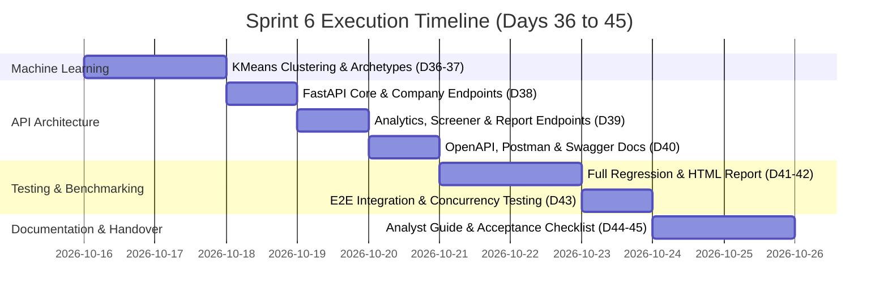
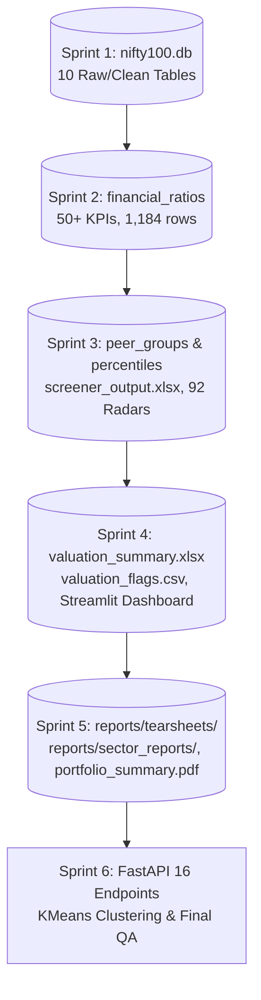

# Sprint 6 Planning Document: REST API, Clustering, Testing & Delivery

**Document Version:** 1.0  
**Date of Preparation:** October 14, 2026  
**Execution Window:** October 16 — October 24, 2026 (Days 36–45)  
**Author:** Platform Engineering, Analytics & QA Team  
**Target Modules:** Module 10 (Reporting & Export), Module 11 (REST API), Module 12 (Clustering, Quality Assurance & Delivery)

---

## 1. Executive Summary & Sprint Objectives

Sprint 6 represents the final capstone sprint of the **Nifty 100 Financial Intelligence Platform**. Sprints 1 through 5 established a pristine data foundation (`nifty100.db`), 50+ computed financial ratios, 6 investment screener presets, institutional valuation models, an 8-screen Streamlit application, 92 company tearsheets, 11 sector reports, and a master portfolio summary PDF.

The primary objectives for Sprint 6 are:
1. **Unsupervised Machine Learning & Clustering (Module 12):** Build an unsupervised learning pipeline utilizing `StandardScaler` and `KMeans(n_clusters=5)` to discover structural archetypes across the 92 Nifty 100 constituents based on multi-dimensional financial ratios (profitability, leverage, growth, and efficiency). Generate `reports/cluster_labels.csv`, elbow analysis, and a correlation matrix heatmap (`reports/heatmap.png`).
2. **Production-Grade FastAPI REST Service (Module 11):** Implement a modular, asynchronous FastAPI server (`src/api/main.py`) exposing **16 well-documented REST endpoints** supporting full CRUD and analytical querying across companies, financial statements, ratios, screener filters, sector benchmarks, peer groups, and report downloads. Auto-generate OpenAPI 3.0 specification (`openapi.json`) and Postman collection (`postman_collection.json`).
3. **End-to-End System Integration & Load Testing:** Connect the Streamlit dashboard and external consumers to the FastAPI layer, conducting load and concurrency benchmarks (10+ concurrent screener queries) documented in `reports/perf_notes.md`.
4. **Comprehensive Documentation & Quality Assurance (Deliverables D-21 to D-23):** Expand the test suite to 220+ tests, achieve >80% code coverage, generate `reports/pytest_report.html`, author `docs/analyst_guide.pdf` (user handbook for screener, dashboard, and API), and sign off on `docs/acceptance_checklist.pdf` (23 validation gates).

---

## 2. Day-by-Day Implementation Breakdown (Days 36–45)

### Day 36–37: Unsupervised Clustering & Cross-Sectional Analysis
- **Focus:** Multi-metric feature extraction, scaling, and KMeans clustering.
- **Tasks:**
  1. Extract 8 core standardized ratios per company: ROE, ROCE, OPM, D/E, Asset Turnover, 3Y Revenue CAGR, CFO Quality Score, and Composite Health Score.
  2. Implement `src/analytics/clustering.py` using `sklearn.preprocessing.StandardScaler` and `sklearn.cluster.KMeans(n_clusters=5, random_state=42)`.
  3. Compute inertia curve (elbow plot) for $k \in [2, 10]$ and silhouette scores to validate $k=5$.
  4. Assign descriptive institutional archetype labels to each cluster (e.g., *"Cash Compounders"*, *"High-Leverage Capital Intensive"*, *"Asset-Light Growth"*, *"Cyclical Turnaround"*, *"Defensive Stables"*).
  5. Export `reports/cluster_labels.csv` mapping `company_id`, ticker, cluster ID, and cluster archetype label.
  6. Generate correlation matrix heatmap across all computed KPIs, saved to `reports/heatmap.png`.

### Day 38: FastAPI Service Setup & Foundation Endpoints
- **Focus:** FastAPI application scaffolding, routers, error handlers, and core entity routes.
- **Tasks:**
  1. Scaffold `src/api/` with modular APIRouter layout:
     - `src/api/routers/companies.py`
     - `src/api/routers/financials.py`
     - `src/api/routers/screener.py`
     - `src/api/routers/sectors.py`
     - `src/api/routers/peers.py`
     - `src/api/routers/reports.py`
  2. Implement global middleware (CORS, request timing, exception handlers).
  3. Implement Endpoints 11.1–11.6:
     - `GET /api/v1/companies` (supports `?sector=` filtering)
     - `GET /api/v1/companies/{ticker}` (full company profile & KPIs)
     - `GET /api/v1/companies/{ticker}/pl` (with `?from_year=` and `?to_year=`)
     - `GET /api/v1/companies/{ticker}/bs` (balance sheet time-series)
     - `GET /api/v1/companies/{ticker}/cashflow` (cash flow statement history)
     - `GET /api/v1/companies/{ticker}/ratios` (14 pre-computed ratios per year)

### Day 39: Screener, Benchmark & Analytical Endpoints
- **Focus:** Query-driven screener engine, sector aggregations, and peer comparisons.
- **Tasks:**
  1. Implement Endpoints 11.7–11.15:
     - `GET /api/v1/companies/{ticker}/tearsheet` (binary PDF streaming from `reports/tearsheets/`)
     - `GET /api/v1/screener` (multi-parameter filtering: `min_roe`, `max_de`, `min_cagr`, `sector`)
     - `GET /api/v1/sectors` (all 11 sectors, company counts, median KPIs)
     - `GET /api/v1/sectors/{sector}/companies` (sector constituent list with summaries)
     - `GET /api/v1/peers/{group_name}` (peer group constituents with percentiles)
     - `GET /api/v1/companies/{ticker}/peers/compare` (8-metric radar comparison data)
     - `GET /api/v1/market-cap/{ticker}` (historical valuation multiples 2019–2024)
     - `GET /api/v1/portfolio/stats` (universe distribution percentiles P10–P90)
     - `GET /api/v1/companies/{ticker}/documents` (annual report filing repository links)
  2. Verify `/health` and `/api/v1/health` with comprehensive table row counts and service uptime.

### Day 40: API Documentation, OpenAPI & Postman Artifacts
- **Focus:** OpenAPI 3.0 export and client consumption testing.
- **Tasks:**
  1. Auto-export OpenAPI specification to `reports/openapi.json`.
  2. Convert OpenAPI spec to Postman Collection v2.1 saved to `reports/postman_collection.json`.
  3. Verify Swagger UI interactive documentation at `/docs` and ReDoc at `/redoc`.
  4. Write automated integration tests for all 16 endpoints in `tests/api/`.

### Day 41–42: Full Test Suite Execution & Coverage Audit
- **Focus:** Regression testing across ETL, ratios, screener, reporting, and API.
- **Tasks:**
  1. Execute comprehensive test suite with `pytest-html` plugin:
     `pytest --html=reports/pytest_report.html --self-contained-html`
  2. Verify all test categories:
     - ETL & Ingestion (Year/ticker normalization, table schemas)
     - Ratio Engine (Profitability, leverage, cash flow, CAGR, banking templates)
     - Screener & Scoring (6 presets, composite rank bounds, SBIN/BEL/HAL handling)
     - Reporting (92 tearsheets, 11 sector reports, portfolio summary PDF)
     - REST API (All 16 endpoints return HTTP 200 with valid JSON/PDF payloads)
  3. Validate test count (target 220+ tests, all passing, 0 critical bugs).

### Day 43: End-to-End System Integration & Concurrency Benchmark
- **Focus:** API-to-Dashboard data flow, caching validation, and concurrency stress testing.
- **Tasks:**
  1. Connect Streamlit dashboard screens to fetch data from FastAPI endpoints.
  2. Perform concurrency load test with 10 concurrent screener queries using `asyncio` / `httpx`.
  3. Log latency percentiles (P50, P95, P99) and memory footprint in `reports/perf_notes.md`.
  4. Optimize database connection pooling and SQLite read-lock concurrency (`timeout=30`, `check_same_thread=False`).

### Day 44: Analyst Guide Authoring
- **Focus:** Technical documentation and user handbook delivery.
- **Tasks:**
  1. Author `docs/analyst_guide.pdf` using ReportLab:
     - Section 1: Platform Overview & Data Architecture.
     - Section 2: Screener Presets & Custom Threshold Tuning.
     - Section 3: Streamlit Interactive Dashboard Navigation Guide.
     - Section 4: REST API Consumption Reference & Sample cURL/Python Requests.
     - Section 5: KPI Definitions & Known Edge-Case Policies (Banking template, SBIN/BEL/HAL).
  2. Update all repository docstrings and `README.md`.

### Day 45: Final Acceptance Audit & Project Release
- **Focus:** Definition of Done verification and formal release tagging.
- **Tasks:**
  1. Execute 23-gate acceptance checklist verifying all requirements AC-01 through AC-19.
  2. Generate and sign `docs/acceptance_checklist.pdf`.
  3. Archive all final deliverables into `reports/` and `docs/`.
  4. Final Git commit, tag `v1.0-release` / `sprint6-complete`, and push to remote repository.

---

## 3. Comprehensive Deliverables List

| Deliverable ID | Artifact Name | Target Path | Sprint Day | Description |
| :--- | :--- | :--- | :---: | :--- |
| **D-19** | **Cluster Labels CSV** | `reports/cluster_labels.csv` | D36–37 | KMeans clustering (k=5) assignments across all 92 constituents |
| **D-19b**| **Correlation Heatmap** | `reports/heatmap.png` | D37 | High-res correlation matrix across 14 fundamental KPIs |
| **D-20** | **FastAPI Server** | `src/api/main.py` + routers | D38–40 | REST API service implementing all 16 specified endpoints |
| **D-20b**| **OpenAPI Specification** | `reports/openapi.json` | D40 | Exported OpenAPI 3.0 specification for API client generation |
| **D-20c**| **Postman Collection** | `reports/postman_collection.json` | D40 | Postman test collection with sample requests and environments |
| **D-21** | **HTML Test Report** | `reports/pytest_report.html` | D41–42 | Self-contained pytest HTML report confirming 220+ passing tests |
| **D-22** | **Performance Benchmark** | `reports/perf_notes.md` | D43 | Latency benchmarks under 10 concurrent requests & memory profile |
| **D-23** | **Analyst User Guide** | `docs/analyst_guide.pdf` | D44 | Institutional user handbook for screener, dashboard, and API |
| **D-24** | **Acceptance Checklist** | `docs/acceptance_checklist.pdf` | D45 | Formal sign-off across all 23 project acceptance criteria |

---

## 4. Exit Criteria & Definition of Done

To achieve sign-off for Sprint 6 and project handoff, the following exit criteria must be met:
1. **API Operational Verification:** All 16 REST endpoints return HTTP 200 with schema-validated JSON payloads or binary PDF streams.
2. **Clustering Quality:** `cluster_labels.csv` exists with exactly 92 companies mapped to 5 distinct clusters with clear institutional archetype names.
3. **Heatmap Generation:** `reports/heatmap.png` exists, is non-empty (> 50KB), and renders clean labels without text overlapping.
4. **Test Suite Integrity:** 220+ automated pytest tests pass with zero failures and zero errors.
5. **FastAPI Health Diagnostic:** `/health` returns status `healthy` with non-zero row counts for all SQLite warehouse tables.
6. **Documentation Completeness:** Both `analyst_guide.pdf` and `acceptance_checklist.pdf` exist in `docs/` and meet institutional styling standards.
7. **Git Release:** Codebase tagged `sprint6-complete` and `v1.0-release` with clean working tree pushed to GitHub.

---

## 5. Data Dependencies from Prior Sprints

Sprint 6 API and clustering services consume data assets created across Sprints 1–5:

- **From Sprint 1 (Data Foundation):** `companies`, `profitandloss`, `balancesheet`, `cashflow`, `sectors`, `stock_prices`, `documents`, `prosandcons`, `market_cap`.
- **From Sprint 2 (Ratio Engine):** `financial_ratios` table with annual profitability, leverage, turnover, and cash flow KPIs (2014–2024).
- **From Sprint 3 (Screener & Peer Analytics):** `peer_groups`, `peer_percentiles`, `screener_output.xlsx` with composite health scores and preset flags.
- **From Sprint 4 (Valuation Module):** `valuation_summary.xlsx`, `valuation_flags.csv`, and relative valuation labels.
- **From Sprint 5 (Publishing Suite):** `reports/tearsheets/` (92 PDFs), `reports/sector_reports/` (11 PDFs), `reports/portfolio_summary.pdf`, `reports/pros_cons_generated.csv`.

---

## 6. Inherited Limitations & Risk Mitigation

1. **Banking & Defense Ratio Policies:**
   - Companies with distinct financial structures (`SBIN`, `BEL`, `HAL`, private banks) omit non-applicable industrial ratios (e.g. Operating Margin, Debt-to-Equity).
   - API endpoints must return `null` instead of artificial zeros, preserving analytical integrity.
2. **SQLite Concurrent Read Locks:**
   - Under multi-threaded FastAPI / Uvicorn workers, SQLite can raise `OperationalError: database is locked`.
   - Mitigation: Use connection pooling with `check_same_thread=False`, URI read-only query mode (`file:db/nifty100.db?mode=ro`), and busy timeouts of 30,000ms.
3. **Cluster Determinism:**
   - Clustering results can vary across operating systems if feature vectors are not deterministically sorted and random seeds are unpinned.
   - Mitigation: Strict alphabetical sorting by `company_id` and explicit `random_state=42` in KMeans.
